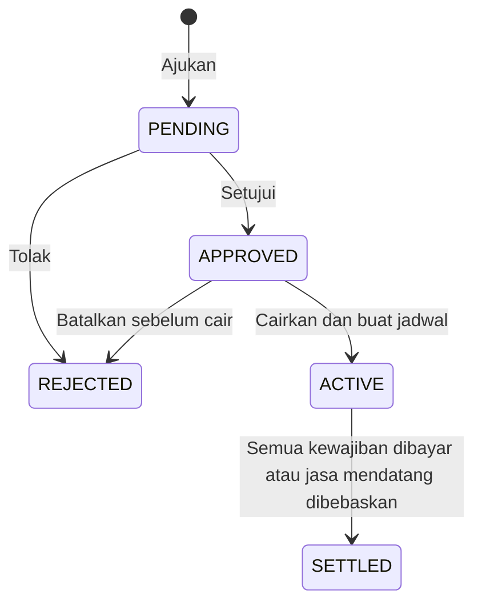
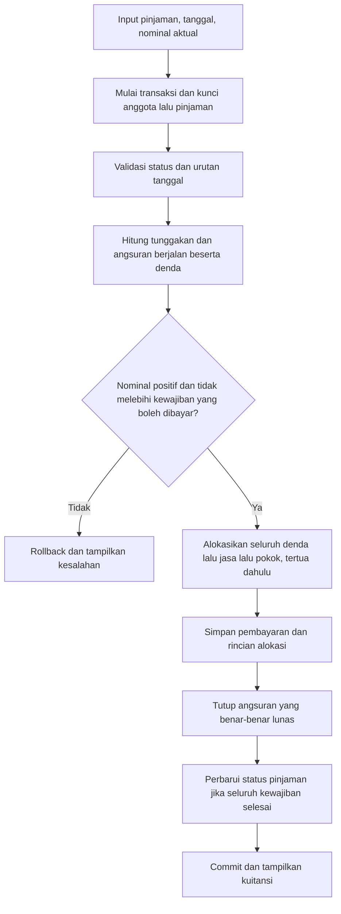
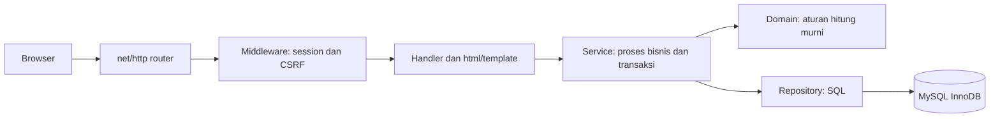
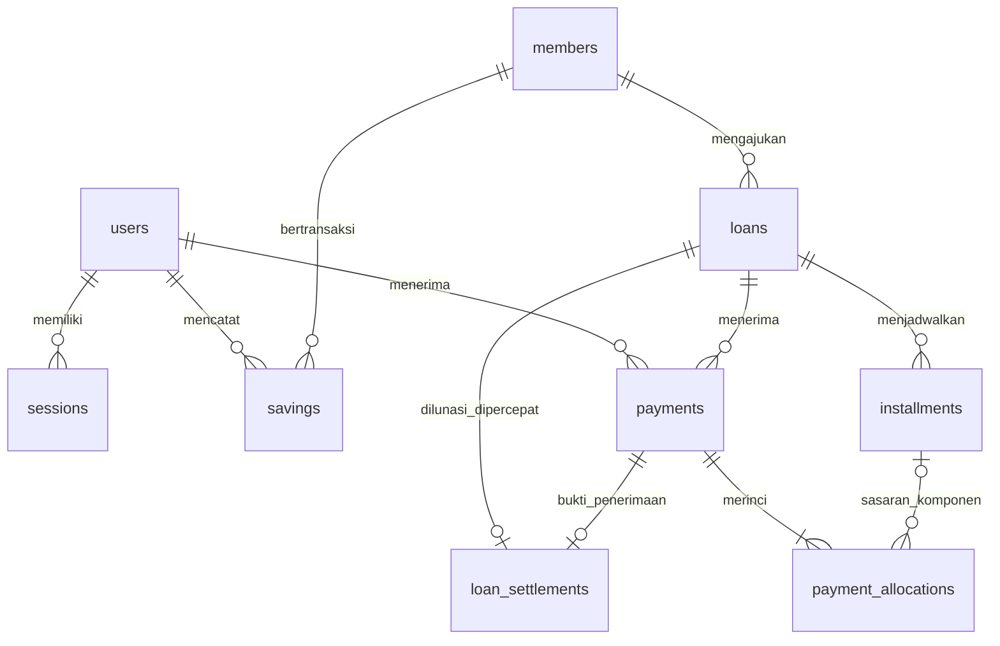

# Rancangan Sistem Koperasi Simpan Pinjam

**Koperasi Karyawan Sejahtera**  
**Teknologi:** Go, MySQL 8.4 LTS (InnoDB), HTML Template, Bootstrap.  
**Pengguna:** dua pengurus, sekitar 250 anggota.  
**Status:** rancangan pengganti yang menyelaraskan requirement, aturan bisnis, database, halaman, dan urutan implementasi.

Dokumen ini memperbaiki ketidaksesuaian dalam `Rancangan_Sistem_Koperasi_Simpan_Pinjam_Lanjutan.docx`. Untuk implementasi, gunakan dokumen Markdown ini sebagai acuan, termasuk pengganti aturan pada gambar mockup lama. Berkas DOCX asli tidak diubah.

## 1. Tujuan dan batas aplikasi

Aplikasi web internal membantu pengurus mencatat simpanan, mengelola pinjaman, menerima pembayaran, dan menyusun laporan. Anggota bertransaksi melalui pengurus; akun atau portal anggota tidak diperlukan untuk memenuhi topik.

| Lingkup | Hasil yang harus tersedia |
| --- | --- |
| Anggota dan simpanan | Pendaftaran, data anggota, simpanan pokok/wajib/sukarela, penarikan sukarela, dan pengembalian simpanan ketika keluar. |
| Pengajuan dan pencairan | Validasi batas pinjaman, tenor, status anggota, serta satu pinjaman aktif. |
| Jadwal angsuran | Jadwal pokok dan jasa sejak pencairan, tanggal jatuh tempo yang benar. |
| Pembayaran | Pembayaran penuh/sebagian, denda harian, alokasi denda–jasa–pokok, kuitansi dan histori. |
| Pelunasan dipercepat | Perhitungan terperinci, penyelesaian tunggakan, biaya administrasi, pembebasan jasa mendatang. |
| Laporan | Kartu pinjaman, sisa kewajiban, daftar tunggakan, serta penerimaan jasa dan denda bulanan. |

Tidak menambahkan transfer bank otomatis, payroll, SHU, penjamin, restrukturisasi, WhatsApp, multi-cabang, atau pembagian peran admin/kasir/pimpinan. Dua pengurus memiliki hak operasional yang sama dan akun berbeda. Cetak laporan memakai halaman ramah cetak dan fasilitas print browser; ekspor Excel bukan syarat topik.

## 2. Sumber aturan dan keputusan desain

### 2.1 Aturan yang langsung berasal dari topik

| ID | Ketentuan |
| --- | --- |
| BR-01 | Simpanan pokok Rp500.000, sekali saat mendaftar. |
| BR-02 | Simpanan wajib Rp100.000 untuk setiap bulan keanggotaan. |
| BR-03 | Simpanan sukarela dapat disetor dengan nominal bebas yang positif dan ditarik kapan saja sepanjang saldo cukup. Tidak ada minimum Rp10.000. |
| BR-04 | Simpanan pokok dan wajib tidak bisa ditarik ketika masih menjadi anggota; dapat dikembalikan ketika keluar. |
| BR-05 | Maksimum pinjaman = 3 × saldo simpanan pokok dan wajib yang benar-benar sudah dibayar. Sukarela tidak diperhitungkan. |
| BR-06 | Tenor bilangan bulat 6–24 bulan. |
| BR-07 | Jasa bulanan = 1% dari pokok awal; tidak berubah mengikuti sisa pokok. |
| BR-08 | Angsuran terdiri dari pokok dan jasa, sama setiap bulan sebelum penyesuaian pembulatan. |
| BR-09 | Jatuh tempo pertama tanggal 10 bulan setelah pencairan; berikutnya tanggal 10 setiap bulan. |
| BR-10 | Maksimal satu pinjaman berstatus ACTIVE untuk setiap anggota. |
| BR-11 | Denda Rp2.000 per hari untuk setiap angsuran yang lewat jatuh tempo dan belum lunas. |
| BR-12 | Pembayaran digunakan untuk denda, kemudian jasa, kemudian pokok. |
| BR-13 | Pelunasan dipercepat = sisa pokok + jasa satu bulan berjalan + administrasi 2% dari sisa pokok. |
| BR-14 | Jasa bulan-bulan setelah pelunasan dipercepat dibebaskan, bukan dianggap dibayar. |
| BR-15 | Pengurus dapat melihat sisa pinjaman, histori pembayaran, anggota menunggak, serta pendapatan jasa dan denda per bulan. |

### 2.2 Keputusan desain untuk ketentuan yang belum dirinci topik

Keputusan berikut adalah kebijakan rancangan, bukan kutipan tambahan dari soal. Implementasi memakai keputusan ini agar tidak ada perhitungan yang menggantung. Pengurus/dosen perlu menyetujuinya sebelum transaksi riil; jika berubah, ubah aturan dan contoh terkait bersama-sama.

| ID | Keputusan yang digunakan |
| --- | --- |
| KD-01 | Uang dicatat dalam rupiah utuh. Persentase dibulatkan half-up ke rupiah terdekat. Pokok bulanan dibagi ke bawah; selisih masuk angsuran terakhir. |
| KD-02 | Semua tanggal bisnis menggunakan Asia/Jakarta. Denda mulai hari setelah jatuh tempo dan mencakup hari pembayaran. Pembayaran pada tanggal jatuh tempo tidak didenda. |
| KD-03 | Pembayaran sebagian tidak menghentikan denda. Denda tetap bertambah Rp2.000/hari pada angsuran tersebut sampai seluruh pokok, jasa, dan dendanya lunas. Denda tidak berbunga. |
| KD-04 | Jika ada beberapa angsuran, prioritas berlaku global: semua denda dahulu, semua jasa berikutnya, lalu semua pokok; dalam setiap komponen, angsuran tertua lebih dahulu. |
| KD-05 | Pembayaran biasa dapat melunasi tunggakan dan angsuran periode berjalan. Kelebihan dari kewajiban tersebut ditolak, bukan hilang atau otomatis menjadi simpanan. Pembayaran pokok masa depan dilakukan melalui pelunasan dipercepat. |
| KD-06 | Periode berjalan dimulai setelah jatuh tempo sebelumnya sampai tanggal jatuh tempo berikutnya, inklusif pada batas akhir. Periode pertama dimulai pada tanggal pencairan. Rinciannya ada di Bagian 5. |
| KD-07 | Jasa periode berjalan yang telah dibayar tidak ditagihkan lagi saat pelunasan. Jasa yang belum dibayar dari periode lewat dan denda tidak dihapus diam-diam. |
| KD-08 | Jika pelunasan dipercepat dilakukan saat menunggak, lunasi seluruh angsuran lewat jatuh tempo dahulu, lalu hitung komponen pelunasan dari sisa pokok setelah tahap tersebut. Kedua tahap menjadi satu penerimaan uang dan satu transaksi database. |
| KD-09 | Pada atau setelah jatuh tempo terakhir, gunakan pelunasan biasa atas sisa kewajiban dan denda; jangan mengenakan biaya administrasi pelunasan dipercepat. |
| KD-10 | Anggota keluar setelah tidak memiliki pinjaman ACTIVE maupun pengajuan PENDING/APPROVED. Pengajuan terbuka harus ditolak lebih dahulu; tidak ada pemotongan simpanan untuk melunasi utang secara otomatis. |
| KD-11 | Pendapatan bulanan menggunakan basis penerimaan: jasa dan denda yang benar-benar dibayar pada bulan tersebut. Pokok, simpanan, dan biaya administrasi tidak dicampur sebagai pendapatan jasa/denda. |
| KD-12 | Tanggal transaksi boleh historis, tetapi tidak boleh melebihi hari ini, mendahului awal kewajiban, atau mendahului transaksi keuangan terakhir anggota. Entri historis harus diurutkan. Transaksi pada tanggal yang sama boleh lebih dari satu. |

Ketidaksamaan angsuran terakhir akibat rupiah utuh adalah pengecualian pembulatan yang disengaja, bukan perubahan metode flat. Jika pengajar menuntut nominal setiap angsuran benar-benar identik, perlu menyepakati pembatasan nominal pinjaman yang habis dibagi tenor; rancangan ini tidak membatasi nominal pinjaman dengan aturan tersebut.

## 3. Kebutuhan fungsional dan nonfungsional

### 3.1 Kebutuhan fungsional

| ID | Kebutuhan dan hasil |
| --- | --- |
| FR-01 | Login/logout pengurus; seluruh data keuangan hanya dapat diakses setelah autentikasi. |
| FR-02 | Tambah, lihat, cari, dan ubah identitas anggota tanpa menghapus histori. |
| FR-03 | Pendaftaran dan penerimaan simpanan pokok Rp500.000 dicatat atomik. |
| FR-04 | Catat simpanan wajib menurut periode kewajibannya, bukan hanya tanggal penerimaan. |
| FR-05 | Setor/ambil sukarela dengan pemeriksaan saldo dan konfirmasi transaksi. |
| FR-06 | Proses keluar anggota beserta pengembalian seluruh saldo simpanan yang tersisa. |
| FR-07 | Ajukan, setujui, tolak, dan cairkan pinjaman dengan validasi ulang saat pencairan. |
| FR-08 | Buat tepat sebanyak tenor baris angsuran pada saat pencairan. |
| FR-09 | Terima nominal pembayaran aktual, hitung denda sampai tanggal bayar, dan simpan alokasi tiap angsuran/komponen. |
| FR-10 | Tampilkan pratinjau pelunasan dipercepat dan rincian final sebelum menerima pembayaran. |
| FR-11 | Tampilkan kartu pinjaman, daftar tunggakan, laporan penerimaan bulanan, serta kuitansi. |
| FR-12 | Simpan pengurus pencatat, tanggal bisnis, waktu pencatatan, dan identitas transaksi untuk penelusuran. |

### 3.2 Kebutuhan nonfungsional

- Nominal memakai `BIGINT` signed MySQL dan `int64` Go, tanpa `float32/float64` pada perhitungan uang. ID dan FK juga memakai `BIGINT` signed agar konsisten dengan tipe Go.
- Penjumlahan, perkalian, dan konversi nominal harus memeriksa overflow; nilai di luar kapasitas ditolak dengan pesan validasi, bukan dibungkus menjadi negatif.
- Database menjadi sumber kebenaran. Seluruh perubahan satu proses keuangan harus commit/rollback bersama.
- Pengurus yang berbeda tidak boleh membuat saldo negatif, dua pencairan aktif, atau pembayaran ganda akibat akses bersamaan.
- Validasi dilakukan di server meskipun form sudah dibatasi.
- Transaksi keuangan yang telah commit tidak memiliki endpoint edit/hapus. Identitas anggota boleh diperbarui, tetapi nomor anggota, tanggal masuk, dan histori keuangan tidak diganti melalui form edit identitas.
- Database dicadangkan setiap hari dan sebelum perubahan skema; uji pemulihan pada database terpisah sebelum pemakaian riil.
- Form memiliki label, pesan kesalahan yang terkait field, navigasi keyboard, dan nominal yang tetap terbaca tanpa bergantung pada warna.
- Target 250 anggota dan dua pengurus cukup memakai satu aplikasi Go dan satu MySQL lokal dengan engine InnoDB. Tidak membutuhkan cloud storage, antrean, cache saldo, microservice, atau kalkulasi denda terjadwal. Akses bersamaan tetap mungkin dari dua pengurus/tab, sehingga transaksi dan row lock tidak dihapus.

## 4. Anggota dan simpanan

### 4.1 Pendaftaran

1. Pengurus mengisi nomor anggota unik, nama, alamat, telepon, tanggal masuk, dan mengonfirmasi uang pokok Rp500.000 telah diterima.
2. Dalam satu transaksi, simpan anggota ACTIVE dan satu setoran POKOK Rp500.000.
3. Jika setoran gagal, anggota tidak ikut tersimpan. Jangan otomatis menganggap simpanan wajib sudah dibayar.
4. Simpanan pokok tidak dapat disetor ulang. Permintaan daftar ulang dengan nomor sama ditolak.

### 4.2 Simpanan wajib dan sukarela

- WAJIB: satu setoran Rp100.000 per anggota per periode bulan; field `period_month` selalu tanggal pertama bulan terkait.
- Tanggal pembayaran dan periode wajib berbeda. Pembayaran Maret untuk kewajiban Januari disimpan dengan tanggal transaksi Maret dan periode Januari.
- Periode tidak boleh sebelum bulan anggota bergabung. Pembayaran untuk periode mendatang boleh dicatat jika uang memang telah diterima; batas pinjaman tetap hanya menghitung uang yang sudah masuk.
- Satu form wajib mencatat satu periode. Membayar beberapa bulan dilakukan sebagai beberapa transaksi agar tidak memerlukan pembagian nominal yang ambigu.
- SUKARELA: setoran positif berapa pun dalam rupiah utuh; penarikan positif tidak melebihi saldo sukarela.
- Anggota EXITED tidak dapat menerima transaksi baru selain melihat histori.

Rumus saldo per jenis:

```text
saldo = total SETOR - total TARIK - total PENGEMBALIAN_KELUAR
batas pinjaman = 3 × (saldo POKOK + saldo WAJIB)
```

Untuk anggota aktif, saldo pokok/wajib hanya berasal dari setoran karena pengembaliannya baru diizinkan pada proses keluar. Tunggakan wajib yang belum dibayar bukan aset anggota dan tidak menambah batas pinjaman.

### 4.3 Keluar anggota

1. Kunci row anggota. Pastikan status ACTIVE, tidak ada pinjaman ACTIVE dan tidak ada pengajuan PENDING/APPROVED.
2. Hitung saldo POKOK, WAJIB, dan SUKARELA dari transaksi yang sudah commit.
3. Tampilkan rincian pengembalian. Pengurus mengonfirmasi nominal dan tanggal penerimaan oleh anggota.
4. Dalam satu transaksi, catat PENGEMBALIAN_KELUAR untuk setiap jenis yang bersaldo positif, ubah status menjadi EXITED, dan simpan `exit_date`.
5. Saldo ketiga jenis menjadi nol. Anggota dan seluruh pinjaman lamanya tetap tersimpan.

PENGEMBALIAN_KELUAR bukan endpoint penarikan biasa. Pokok/wajib tidak boleh ditarik hanya dengan mengirim `saving_type` berbeda pada form sukarela. Aktivasi ulang anggota yang sudah keluar bukan bagian lingkup ini.

## 5. Pinjaman, jadwal, dan pembulatan

### 5.1 Status dan validasi



- Pengajuan hanya untuk anggota ACTIVE, pokok positif, tidak melebihi batas, dan tenor 6–24.
- Untuk menyederhanakan pekerjaan dua pengurus, satu anggota hanya boleh mempunyai satu proses terbuka: PENDING, APPROVED, atau ACTIVE. Ini aturan operasional rancangan yang lebih ketat daripada larangan dua pinjaman aktif.
- Persetujuan bukan pencairan. Jadwal belum dibuat ketika baru PENDING atau APPROVED.
- Saat pencairan, kunci anggota dan pinjaman; periksa kembali saldo, batas, status, tenor, serta tanggal pencairan tidak sebelum pengajuan atau transaksi terakhir anggota.
- Simpan tanggal pencairan, buat jadwal, dan ubah status ACTIVE dalam satu transaksi. Pencairan ulang terhadap pinjaman yang sama tidak membuat jadwal baru.
- Penolakan/pembatalan menyimpan alasan dan pengurus pemroses. Pinjaman ACTIVE tidak dapat ditolak atau dihapus.

### 5.2 Perhitungan jadwal

Misalkan `P` pokok awal dan `n` tenor:

```text
pokok reguler = P div n
pokok angsuran 1..n-1 = pokok reguler
pokok angsuran n = P - pokok reguler × (n - 1)
jasa bulanan = round_half_up(P × 1 / 100)
angsuran = pokok angsuran + jasa bulanan
```

Implementasi pembulatan bilangan positif dapat memakai pembagian dan sisa bagi untuk menghindari perkalian yang tidak perlu. Contoh jasa: `P/100`, ditambah satu bila `P%100 >= 50`. Administrasi 2% setara `P/50`, ditambah satu bila `P%50 >= 25`.

Jumlah pokok seluruh jadwal harus tepat `P`. Nilai jasa bulanan disimpan dalam setiap angsuran dan selalu berasal dari pokok awal, bukan sisa pokok.

Jika nominal pinjaman sangat kecil sehingga suatu baris jadwal memiliki pokok dan jasa sama-sama nol, tutup baris itu pada tanggal pencairan. Baris tanpa kewajiban tidak boleh mulai menghasilkan denda ketika melewati due_date. Ini menjaga nominal positif tetap sah tanpa menambahkan minimum pinjaman yang tidak ada pada topik.

| Contoh | Pokok bulanan | Jasa bulanan | Total |
| --- | --- | --- | --- |
| Rp6.000.000, 12 bulan | Rp500.000 | Rp60.000 | Rp560.000/bulan |
| Rp10.000.000, 10 bulan | Rp1.000.000 | Rp100.000 | Rp1.100.000/bulan |
| Rp1.000.000, 6 bulan | Lima kali Rp166.666; terakhir Rp166.670 | Rp10.000 | Lima kali Rp176.666; terakhir Rp176.670 |

### 5.3 Kalender jatuh tempo dan periode berjalan

Untuk pencairan 20 Januari 2026 dengan tenor 12 bulan:

- Angsuran 1: 10 Februari 2026.
- Angsuran 2: 10 Maret 2026.
- Angsuran 12: 10 Januari 2027.

Bangun tanggal dari tahun, bulan, dan hari `10`; jangan menambahkan 30 hari atau menyalin tanggal pencairan. Pencairan 31 Januari tetap menghasilkan 10 Februari; pencairan Desember melewati pergantian tahun dengan benar.

Definisi periode untuk pembayaran dan pelunasan:

- Periode pertama: tanggal pencairan sampai jatuh tempo pertama, termasuk kedua tanggal.
- Periode berikutnya: hari setelah jatuh tempo sebelumnya sampai jatuh tempo periode tersebut.
- Pada 10 Maret, periode berjalan adalah angsuran jatuh tempo 10 Maret.
- Pada 11 Maret, periode berjalan adalah angsuran jatuh tempo 10 April.
- Setelah jatuh tempo terakhir, tidak dibuat periode atau jasa baru.

Sisa pokok dan sisa tagihan berbeda:

```text
sisa pokok = pokok awal - total alokasi POKOK yang dibayar
sisa jasa terjadwal = jasa jadwal - alokasi JASA dibayar - jasa dibebaskan
sisa denda = denda terakumulasi - alokasi DENDA dibayar
sisa kewajiban terjadwal = sisa pokok + sisa jasa terjadwal + sisa denda
```

Tampilkan sisa pokok dan sisa kewajiban secara terpisah. Sisa kewajiban terjadwal bukan otomatis nilai pelunasan dipercepat.

## 6. Denda dan pembayaran sebagian

### 6.1 Perhitungan denda

Untuk setiap angsuran, tentukan `cutoff` sebagai tanggal perhitungan, atau tanggal lunas bila angsuran telah lunas lebih dahulu:

```text
hari terlambat = max(0, jumlah_hari_kalender(cutoff - due_date))
denda total = hari terlambat × Rp2.000
denda tersisa = denda total - total alokasi DENDA sampai tanggal perhitungan
```

- Gunakan selisih tanggal kalender, bukan pembagian durasi jam lokal atau waktu input HTTP.
- Status lunas mensyaratkan sisa pokok, jasa yang ditagih, dan denda sama-sama nol.
- Setelah lunas, `closed_on` membekukan pertumbuhan denda pada tanggal penutupan. Membuka laporan bulan berikutnya tidak menciptakan denda baru.
- Pembayaran pada tanggal yang sama tidak menambah satu hari denda lagi.
- Denda dinamis tidak perlu disimpan ulang setiap malam. Yang disimpan adalah tanggal jadwal, tanggal penutupan, dan alokasi denda yang benar-benar diterima.
- Pada tanggal historis sebelum angsuran ditutup, gunakan tanggal historis tersebut; jangan langsung memakai keadaan terbaru.

### 6.2 Alur pembayaran biasa



Urutan tersebut wajib: denda dihitung sebelum uang dialokasikan, bukan sesudah status diperbarui.

Daftar yang dapat dibayar terdiri dari angsuran lewat jatuh tempo dan angsuran periode berjalan. Iterasi komponen dilakukan di luar iterasi angsuran: DENDA untuk seluruh daftar, lalu JASA untuk seluruh daftar, lalu POKOK untuk seluruh daftar. Jangan menyelesaikan pokok angsuran pertama ketika denda angsuran kedua masih tersisa.

### 6.3 Contoh pembayaran sebagian

Pinjaman Rp6.000.000, 12 bulan; satu angsuran Rp500.000 pokok + Rp60.000 jasa. Jatuh tempo 10 Februari, pembayaran 14 Februari sebesar Rp100.000:

| Komponen | Alokasi |
| --- | --- |
| Denda, 4 × Rp2.000 | Rp8.000 |
| Jasa | Rp60.000 |
| Pokok | Rp32.000 |
| Total uang diterima | Rp100.000 |
| Sisa pokok angsuran | Rp468.000 |

Angsuran berstatus PARTIAL. Jika diselesaikan 15 Februari, denda total menjadi Rp10.000; karena Rp8.000 sudah dibayar, tambahan yang ditagih Rp2.000. Sisa angsuran yang harus dibayar hari itu Rp470.000.

Kasus pembayaran hanya denda juga sah: bayar Rp5.000 pada 14 Februari menyisakan denda Rp3.000, jasa Rp60.000, dan pokok Rp500.000. Jangan menganggap jasa/pokok ikut berkurang.

### 6.4 Status tampilan

Status angsuran dihitung dari jadwal, pembebasan, dan alokasi, bukan diubah bebas melalui form:

- UNPAID: belum ada pembayaran dan masih memiliki kewajiban.
- PARTIAL: sudah ada pembayaran tetapi masih memiliki kewajiban.
- PAID: seluruh kewajiban nol tanpa pembebasan jasa.
- SETTLED_EARLY: ditutup melalui pelunasan dengan jasa mendatang dibebaskan.

OVERDUE adalah penanda tambahan ketika `due_date < as_of_date` dan kewajiban masih ada; dapat berlaku untuk UNPAID atau PARTIAL. Tanggal hari ini sama dengan due date belum menunggak.

## 7. Pelunasan dipercepat

### 7.1 Rincian perhitungan

Pelunasan dipercepat hanya untuk pinjaman ACTIVE dan tanggal sebelum jatuh tempo terakhir. Pratinjau tidak mengubah database.

1. Hitung seluruh angsuran yang `due_date < settlement_date`: sisa pokok, jasa, dan denda.
2. Simulasikan pembayaran biasa untuk melunasi seluruh tunggakan tersebut dengan prioritas denda–jasa–pokok.
3. Setelah simulasi, hitung `P_sisa`, yaitu pokok yang belum dibayar.
4. Tentukan angsuran periode berjalan; `J_berjalan` adalah jasa periode tersebut yang belum dibayar. Tidak menagihkan ulang jasa yang sudah dibayar sebagian/penuh.
5. Administrasi `A = round_half_up(P_sisa × 2 / 100)`.
6. Bagian pelunasan dipercepat `L = P_sisa + J_berjalan + A`.
7. Uang yang diterima dalam transaksi ini `T = pelunasan_tunggakan + L`.
8. Bebaskan sisa jasa pada periode setelah periode berjalan, tutup seluruh angsuran, dan ubah pinjaman SETTLED dalam transaksi yang sama.

Penambahan tahap tunggakan adalah keputusan KD-08: rumus pelunasan pokok tidak dipakai untuk menghapus kewajiban lama. UI harus menampilkan tahap tunggakan dan tahap pelunasan terpisah agar biaya tidak tersembunyi. Pada atau setelah jatuh tempo terakhir, cukup bayar seluruh kewajiban biasa tanpa administrasi 2% dan tanpa jasa baru.

Jika jasa periode mendatang pernah dibayar melalui data historis yang diimpor, jangan mengembalikannya otomatis; data awal harus direkonsiliasi sebelum aplikasi dibuka. Alur pembayaran aplikasi ini tidak mengizinkan pembayaran jasa periode yang belum berjalan.

### 7.2 Contoh tanpa tunggakan

Pinjaman Rp6.000.000, tenor 12, dicairkan 20 Januari 2026. Angsuran 10 Februari dan 10 Maret sudah lunas. Pelunasan 5 April 2026:

| Komponen | Nominal |
| --- | --- |
| Sisa pokok setelah dua angsuran | Rp5.000.000 |
| Jasa periode 11 Maret–10 April | Rp60.000 |
| Administrasi 2% × Rp5.000.000 | Rp100.000 |
| Total pelunasan | Rp5.160.000 |
| Jasa periode Mei–Januari, 9 × Rp60.000 | Rp540.000 dibebaskan |

Jika jasa periode April sudah dibayar Rp30.000, total pelunasan menjadi Rp5.130.000. Pembayaran tersebut tidak mengubah jasa bulanan menjadi 1% dari sisa pokok.

### 7.3 Contoh dengan tunggakan

Pinjaman dan pembayaran Februari–Maret sama seperti contoh sebelumnya, tetapi pelunasan dilakukan 15 April dan angsuran 10 April belum dibayar:

| Tahap | Rincian | Nominal |
| --- | --- | --- |
| Selesaikan tunggakan April | Pokok Rp500.000 + jasa Rp60.000 + denda 5 × Rp2.000 | Rp570.000 |
| Sisa pokok sesudah tunggakan | Rp5.000.000 − Rp500.000 | Rp4.500.000 |
| Jasa berjalan | Periode 11 April–10 Mei | Rp60.000 |
| Administrasi | 2% × Rp4.500.000 | Rp90.000 |
| Bagian pelunasan dipercepat | Rp4.500.000 + Rp60.000 + Rp90.000 | Rp4.650.000 |
| Total uang diterima | Rp570.000 + Rp4.650.000 | Rp5.220.000 |
| Jasa sesudah periode berjalan | Juni–Januari, 8 × Rp60.000 | Rp480.000 dibebaskan |

### 7.4 Penyimpanan dan konsistensi

- Satu row `payments` dengan jenis EARLY_SETTLEMENT menampung seluruh uang yang diterima, termasuk tahap tunggakan dan administrasi.
- `payment_allocations` menyimpan setiap komponen DENDA/JASA/POKOK/ADMIN. Jumlah alokasi harus tepat sama dengan uang diterima.
- `loan_settlements` menyimpan snapshot rincian perhitungan untuk kuitansi, bukan penerimaan uang kedua.
- Pembebasan jasa disimpan pada angsuran, bukan sebagai alokasi JASA yang dibayar. Tidak menambah pendapatan.
- POST pelunasan mengunci data dan menghitung ulang. Jika nominal/rincian telah berubah sejak pratinjau, rollback dan minta pengurus melihat rincian baru; jangan menerima nominal lama diam-diam.

## 8. Arsitektur dan kontrak package



| Package/direktori | Tanggung jawab | Tidak dikerjakan di sini |
| --- | --- | --- |
| `internal/domain` | Model, konstanta kebijakan, perhitungan jadwal/denda/alokasi/pelunasan yang murni. | SQL, HTTP, pembacaan waktu global. |
| `internal/config` | Baca dan validasi environment saat startup. | Aturan pinjaman atau global mutable config. |
| `internal/database` | Membuka pool MySQL, ping, dan penutupan koneksi. | Menjalankan transaksi bisnis atau migrasi otomatis saat server hidup. |
| `internal/repository` | SQL berparameter, mapping row, query agregat, dan row lock. | Memulai/commit transaksi bisnis atau menghitung jasa. |
| `internal/service` | Validasi proses, otorisasi anggota aktif, transaksi, urutan lock, dan pemanggilan domain/repository. | Membuat HTML atau membaca form. |
| `internal/middleware` | Memuat sesi, melindungi route, memeriksa CSRF. | Mengubah transaksi keuangan. |
| `internal/handler` | Parse/validasi bentuk input, memanggil service, render halaman/redirect. | Menghitung saldo atau denda sendiri. |
| `internal/router` | Menyambungkan method/path dengan handler dan middleware. | Query database atau perhitungan uang. |
| `cmd/server` | Merangkai dependensi dan menjalankan server. | Aturan bisnis. |
| `web/templates`, `web/static` | HTML, Bootstrap lokal, CSS cetak, dan JavaScript ringan bila diperlukan. | Menjadi satu-satunya tempat validasi. |
| `migrations` | Skema, indeks, constraint, dan perubahan database berversi. | Mengisi transaksi keuangan contoh pada database produksi. |

Gunakan `database/sql` dengan driver [`github.com/go-sql-driver/mysql`](https://github.com/go-sql-driver/mysql); password memakai `golang.org/x/crypto/bcrypt`. Fondasi saat ini memakai Go minimal **1.26.0**, driver mysql v1.10.1, dan golang.org/x/crypto v0.58.0; versi terkunci di go.mod/go.sum. Selain dua kebutuhan tersebut, utamakan standard library. Tidak perlu ORM, framework HTTP, generic repository, dependency-injection framework, atau package util serbaguna.

Repository memakai satu interface kecil `DBTX` untuk operasi SQL yang sama pada `*sql.DB` dan `*sql.Tx`. Service memulai transaksi dan meneruskan `tx` ke seluruh query dalam proses tersebut. Jangan ada query saldo melalui `db` di tengah proses yang seharusnya memakai `tx`.

Query MySQL menggunakan placeholder `?`. INSERT biasa melalui `ExecContext`, lalu ambil ID dengan `sql.Result.LastInsertId()`; jangan menyisipkan input ke string SQL. Gunakan daftar kolom eksplisit saat INSERT/SELECT, termasuk agar kolom generated untuk indeks tidak ikut dimasukkan sebagai input.

Fungsi domain menerima tanggal dan snapshot kewajiban sebagai argumen; tidak memanggil `time.Now()` sendiri. Dengan demikian perhitungan yang sama dipakai pembayaran, pratinjau, pelunasan, dan laporan.

### 8.1 Struktur berkas

```text
koperasi-app/
├── cmd/server/main.go
├── internal/
│   ├── config/config.go
│   ├── database/mysql.go
│   ├── domain/
│   │   ├── member.go
│   │   ├── saving.go
│   │   ├── loan.go
│   │   ├── payment.go
│   │   ├── money.go
│   │   ├── schedule.go
│   │   ├── penalty.go
│   │   ├── allocation.go
│   │   ├── settlement.go
│   │   └── *_test.go
│   ├── repository/
│   │   ├── dbtx.go
│   │   ├── users.go
│   │   ├── sessions.go
│   │   ├── members.go
│   │   ├── savings.go
│   │   ├── loans.go
│   │   ├── installments.go
│   │   ├── payments.go
│   │   ├── settlements.go
│   │   └── reports.go
│   ├── service/
│   │   ├── service.go
│   │   ├── auth.go
│   │   ├── members.go
│   │   ├── savings.go
│   │   ├── loans.go
│   │   ├── payments.go
│   │   ├── settlements.go
│   │   ├── reports.go
│   │   └── *_test.go
│   ├── middleware/{session.go,auth.go,csrf.go}
│   ├── handler/{handler.go,auth.go,dashboard.go,members.go,savings.go,loans.go,payments.go,settlements.go,reports.go}
│   └── router/router.go
├── web/
│   ├── templates/
│   │   ├── layouts/base.html
│   │   ├── auth/login.html
│   │   ├── dashboard/index.html
│   │   ├── members/{index.html,form.html,detail.html,exit.html}
│   │   ├── savings/{index.html,deposit.html,withdrawal.html}
│   │   ├── loans/{index.html,form.html,detail.html,schedule.html}
│   │   ├── payments/{form.html,receipt.html}
│   │   ├── settlements/{preview.html,receipt.html}
│   │   └── reports/{loan_card.html,arrears.html,monthly.html}
│   └── static/{css,js,bootstrap}
├── migrations/{001_schema.sql,002_constraints_indexes.sql}
├── .env.example
├── .gitignore
├── go.mod
├── go.sum
└── README.md
```

Nama dalam `{...}` adalah singkatan daftar berkas, bukan nama direktori literal. Buat berkas ketika fiturnya dikerjakan; jangan mengisi semua berkas dengan stub sejak awal. Unit test berada dekat kode yang diuji, bukan membuat package `tests` terpisah untuk setiap fungsi.

## 9. Database dan ERD

### 9.1 Prinsip pemodelan

Terdapat sembilan tabel: `users`, `sessions`, `members`, `savings`, `loans`, `installments`, `payments`, `payment_allocations`, `loan_settlements`.

Perubahan terhadap rancangan lama:

- Pembayaran terhubung ke pinjaman; rincian alokasi terhubung ke angsuran. Satu pembayaran dapat menyelesaikan beberapa angsuran.
- Tabel `loan_settlement_items` tidak diperlukan karena komponen uang sudah disimpan di `payment_allocations`.
- Ditambahkan `sessions` untuk sesi server-side dan simpanan wajib memiliki periode eksplisit.
- Saldo, `principal_paid`, dan `interest_paid` tidak disalin sebagai kolom agregat. Hitung dari transaksi/alokasi agar tidak memiliki dua sumber nilai yang bisa berbeda.
- Status angsuran merupakan hasil perhitungan. `closed_on` hanya menyimpan tanggal penutupan untuk membekukan denda.



Relasi pengurus pemroses pinjaman dan keluar anggota dijabarkan pada dictionary. Alokasi ADMIN tidak memiliki angsuran; komponen lainnya wajib memiliki angsuran dari pinjaman pembayaran yang sama.

### 9.2 Data dictionary

Seluruh tabel menggunakan **MySQL 8.4 LTS, ENGINE=InnoDB, utf8mb4** agar transaksi, foreign key, dan CHECK benar-benar berlaku. Semua FK histori keuangan memakai `ON DELETE RESTRICT`; tipe serta signedness FK harus sama dengan PK tujuan. Kolom wajib `NOT NULL`, kecuali yang disebut nullable. PK `id BIGINT NOT NULL AUTO_INCREMENT PRIMARY KEY`. Waktu pencatatan `DATETIME(6) NOT NULL DEFAULT CURRENT_TIMESTAMP(6)` disimpan dalam UTC; tanggal bisnis tetap `DATE`. Kolom BOOLEAN adalah alias TINYINT di MySQL dan harus memiliki CHECK nilai 0/1. Kolom generated tambahan untuk indeks dijelaskan pada Bagian 9.3, bersifat nullable dan bukan input aplikasi. MariaDB pada sebagian paket XAMPP bukan otomatis setara dengan target MySQL 8.4 ini.

#### users

| Kolom | Tipe | Ketentuan |
| --- | --- | --- |
| id | BIGINT | PK. |
| name | VARCHAR(100) | Nama pengurus. |
| username | VARCHAR(50) | Unik, normalisasi huruf kecil sebelum simpan/cari. |
| password_hash | TEXT | Hash bcrypt, bukan password asli. |
| is_active | BOOLEAN | Akun nonaktif tidak boleh login atau melanjutkan sesi. |
| created_at | DATETIME(6) | Waktu dibuat dalam UTC. |

Tidak membutuhkan kolom role karena hanya ada satu jenis hak akses.

#### sessions

| Kolom | Tipe | Ketentuan |
| --- | --- | --- |
| id | BIGINT | PK. |
| token_hash | BINARY(32) | SHA-256 token acak, unik; cookie berisi token asli. |
| user_id | BIGINT | FK users, nullable untuk sesi formulir login sebelum autentikasi. |
| csrf_token | CHAR(64) | Token acak untuk form POST, bukan token sesi. |
| created_at | DATETIME(6) | Waktu dibuat dalam UTC. |
| expires_at | DATETIME(6) | Batas berlaku delapan jam untuk sesi login, dalam UTC. |

#### members

| Kolom | Tipe | Ketentuan |
| --- | --- | --- |
| id | BIGINT | PK. |
| member_number | VARCHAR(30) | Unik, tidak boleh berubah setelah pendaftaran. |
| name | VARCHAR(100) | Nama. |
| address | TEXT | Alamat. |
| phone | VARCHAR(20) | Telepon, bukan angka untuk operasi aritmetika. |
| join_date | DATE | Tanggal masuk. |
| status | VARCHAR(10) | ACTIVE/EXITED. |
| exit_date | DATE | Nullable jika ACTIVE. |
| exit_user_id | BIGINT | FK users, nullable jika ACTIVE. |
| created_by | BIGINT | FK users. |
| created_at | DATETIME(6) | Waktu dibuat dalam UTC. |

#### savings

| Kolom | Tipe | Ketentuan |
| --- | --- | --- |
| id | BIGINT | PK; nomor bukti dapat diturunkan dari ID. |
| member_id | BIGINT | FK members. |
| user_id | BIGINT | FK users, pengurus pencatat. |
| saving_type | VARCHAR(10) | POKOK/WAJIB/SUKARELA. |
| transaction_type | VARCHAR(25) | SETOR/TARIK/PENGEMBALIAN_KELUAR. |
| amount | BIGINT | Positif, rupiah utuh. |
| period_month | DATE | Wajib untuk SETOR WAJIB; selain itu NULL. |
| transaction_date | DATE | Tanggal uang diterima/diserahkan. |
| request_key | CHAR(32) | Kunci acak anti-submit ganda, unik. |
| description | TEXT | Keterangan, nullable. |
| created_at | DATETIME(6) | Waktu pencatatan dalam UTC. |

Pada pendaftaran dan keluar anggota, request key untuk setiap row simpanan dibuat server di dalam proses yang sama. Pengulangan proses ditahan nomor anggota unik atau status EXITED. Pada form setoran/penarikan biasa, request key berasal dari form yang diterbitkan server.

#### loans

| Kolom | Tipe | Ketentuan |
| --- | --- | --- |
| id | BIGINT | PK. |
| member_id | BIGINT | FK members. |
| principal | BIGINT | Pokok awal positif. |
| tenor_months | SMALLINT | 6–24. |
| application_date | DATE | Tanggal pengajuan. |
| status | VARCHAR(10) | PENDING/APPROVED/ACTIVE/SETTLED/REJECTED. |
| created_by | BIGINT | FK users. |
| approved_by | BIGINT | FK users, nullable sebelum disetujui. |
| disbursed_by | BIGINT | FK users, nullable sebelum cair. |
| rejected_by | BIGINT | FK users, nullable jika tidak ditolak. |
| disbursement_date | DATE | Nullable sebelum cair. |
| settled_on | DATE | Nullable sebelum lunas. |
| rejection_reason | TEXT | Wajib ketika REJECTED, selain itu nullable. |
| created_at | DATETIME(6) | Waktu dibuat dalam UTC. |

Tarif 1%, denda Rp2.000, dan administrasi 2% adalah konstanta domain, bukan opsi yang dapat diedit pengurus. Jasa yang benar-benar ditagih disimpan pada jadwal; administrasi aktual disimpan pada alokasi dan snapshot pelunasan.

#### installments

| Kolom | Tipe | Ketentuan |
| --- | --- | --- |
| id | BIGINT | PK. |
| loan_id | BIGINT | FK loans. |
| installment_number | SMALLINT | 1 sampai tenor, unik dalam pinjaman. |
| due_date | DATE | Selalu tanggal 10. |
| principal_due | BIGINT | Pokok terjadwal, tidak negatif. |
| interest_due | BIGINT | Jasa flat terjadwal, tidak negatif. |
| interest_waived | BIGINT | Default 0, tidak melebihi interest_due. |
| waived_on | DATE | Nullable; terisi jika interest_waived positif. |
| closed_on | DATE | Nullable; tanggal seluruh kewajiban diselesaikan. |

Jadwal angsuran tidak dihapus ketika dilunasi dipercepat. Pembebasan hanya jasa setelah periode berjalan. Pokok seluruh angsuran tetap dilunasi melalui alokasi POKOK.

#### payments

| Kolom | Tipe | Ketentuan |
| --- | --- | --- |
| id | BIGINT | PK; dasar nomor kuitansi. |
| loan_id | BIGINT | FK loans. |
| user_id | BIGINT | FK users. |
| payment_type | VARCHAR(20) | REGULAR/EARLY_SETTLEMENT. |
| payment_date | DATE | Tanggal penerimaan. |
| amount | BIGINT | Total uang positif yang diterima. |
| request_key | CHAR(32) | Unik, untuk mencegah submit berulang. |
| created_at | DATETIME(6) | Waktu pencatatan dalam UTC. |

Tidak perlu status PENDING karena tabel ini hanya menyimpan penerimaan yang sudah dikonfirmasi. Pratinjau tidak membuat payment.

#### payment_allocations

| Kolom | Tipe | Ketentuan |
| --- | --- | --- |
| id | BIGINT | PK. |
| payment_id | BIGINT | FK payments. |
| installment_id | BIGINT | FK installments, nullable hanya untuk ADMIN. |
| component_type | VARCHAR(10) | DENDA/JASA/POKOK/ADMIN. |
| amount | BIGINT | Positif. |

Satu payment dapat mempunyai banyak baris untuk komponen sama pada angsuran berbeda. Tidak boleh ada alokasi Rp0. Alokasi yang seluruhnya dibayar ke satu angsuran tidak menghilangkan rincian komponennya.

#### loan_settlements

| Kolom | Tipe | Ketentuan |
| --- | --- | --- |
| id | BIGINT | PK. |
| loan_id | BIGINT | FK loans, unik. |
| payment_id | BIGINT | FK payments, unik; harus EARLY_SETTLEMENT untuk loan yang sama. |
| current_installment_id | BIGINT | FK installments, milik loan yang sama. |
| arrears_amount | BIGINT | Total tahap tunggakan, tidak negatif. |
| remaining_principal | BIGINT | Sisa pokok setelah tahap tunggakan. |
| current_interest | BIGINT | Sisa jasa periode berjalan yang dibayar. |
| administration_fee | BIGINT | Administrasi aktual. |
| waived_interest | BIGINT | Total jasa mendatang yang dibebaskan. |

Tanggal/pengurus/total penerimaan diambil dari `payments`; tidak disalin lagi. Snapshot ini menjelaskan perhitungan kuitansi, bukan sumber pendapatan tambahan.

### 9.3 Constraint dan indeks

Buat constraint umum: enum nilai status/jenis melalui CHECK, amount positif, nilai jadwal tidak negatif, tenor 6–24, urutan tanggal valid, FK, dan UNIQUE nomor anggota/username.

MySQL tidak menyediakan indeks unik dengan klausa WHERE. Gunakan **generated column nullable + UNIQUE** untuk batas kondisional. MySQL mengizinkan beberapa NULL pada indeks unik, sehingga row yang tidak memenuhi kondisi tetap dapat mempunyai banyak histori. Kolom guard dihitung database dan tidak boleh diisi/diubah melalui form.

Pada `001_schema.sql`, buat sembilan tabel beserta PK/FK/CHECK, unique key umum termasuk nomor angsuran, dan indeks awalan FK untuk query simpanan/pembayaran/alokasi. Indeks tersebut dideklarasikan sebelum FK agar InnoDB tidak membuat indeks pendukung duplikat. Setelah itu, `002_constraints_indexes.sql` menambahkan guard dan indeks tanggal berikut:

```sql
ALTER TABLE loans
    ADD COLUMN open_loan_guard TINYINT
        GENERATED ALWAYS AS (
            CASE WHEN status IN ('PENDING', 'APPROVED', 'ACTIVE')
                 THEN 1 ELSE NULL END
        ) VIRTUAL,
    ADD UNIQUE KEY uq_member_open_loan (member_id, open_loan_guard);

ALTER TABLE savings
    ADD COLUMN principal_deposit_guard TINYINT
        GENERATED ALWAYS AS (
            CASE WHEN saving_type = 'POKOK' AND transaction_type = 'SETOR'
                 THEN 1 ELSE NULL END
        ) VIRTUAL,
    ADD COLUMN exit_refund_guard TINYINT
        GENERATED ALWAYS AS (
            CASE WHEN transaction_type = 'PENGEMBALIAN_KELUAR'
                 THEN 1 ELSE NULL END
        ) VIRTUAL,
    ADD UNIQUE KEY uq_member_principal_deposit
        (member_id, principal_deposit_guard),
    ADD UNIQUE KEY uq_member_mandatory_period
        (member_id, period_month),
    ADD UNIQUE KEY uq_member_exit_refund_type
        (member_id, saving_type, exit_refund_guard);

CREATE INDEX idx_installments_due_date
    ON installments (due_date, loan_id);
CREATE INDEX idx_payments_monthly
    ON payments (payment_date, id);
```

Tambahkan UNIQUE `savings.request_key`, `payments.request_key`, `sessions.token_hash`, `loan_settlements.loan_id`, dan `loan_settlements.payment_id` pada definisi tabel. Indeks FK lain ditambahkan bila query terkait memerlukannya, bukan membuat indeks setiap kolom.

`period_month` hanya terisi pada SETOR WAJIB, sehingga UNIQUE(member_id, period_month) sudah membatasi satu setoran per bulan tanpa generated column keempat. Row sukarela, pokok, dan pengembalian memakai period_month NULL. Setelah pinjaman SETTLED/REJECTED, open_loan_guard otomatis NULL dan anggota dapat memiliki pinjaman baru tanpa menghapus histori lama. [Referensi MySQL: indeks pada generated column](https://dev.mysql.com/doc/refman/8.4/en/create-table-secondary-indexes.html).

InnoDB membuat indeks pendukung FK bila belum ada indeks yang sesuai. Sebelum menambahkan indeks lain, periksa `SHOW INDEX` agar tidak menduplikasi indeks pendukung yang sudah memenuhi kebutuhan query.

CHECK yang wajib:

- SETOR POKOK tepat Rp500.000; SETOR WAJIB tepat Rp100.000.
- TARIK hanya untuk SUKARELA; pengembalian POKOK/WAJIB hanya melalui PENGEMBALIAN_KELUAR.
- `period_month` terisi jika dan hanya jika SETOR WAJIB, serta merupakan tanggal pertama bulan.
- `exit_date` dan `exit_user_id` terisi jika dan hanya jika anggota EXITED; exit_date tidak sebelum join_date.
- `interest_waived` antara nol dan interest_due; waived_on terisi jika dan hanya jika pembebasan positif.
- ADMIN mempunyai installment_id NULL; DENDA/JASA/POKOK mempunyai installment_id yang tidak NULL.
- Status ACTIVE/SETTLED harus mempunyai tanggal dan pengurus pencairan; status SETTLED harus mempunyai settled_on yang tidak sebelum pencairan.

Aturan lintas row tidak dapat dibuat sebagai CHECK sederhana: saldo cukup, total alokasi sama dengan amount, angsuran milik pinjaman yang sama, jumlah jadwal sama dengan tenor, snapshot pelunasan konsisten, dan seluruh kewajiban sebelum penutupan. Periksa aturan tersebut dalam service di bawah lock dan transaksi; akun aplikasi tidak boleh menerima akses SQL dari pengguna. Jangan menulis CHECK dengan subquery lintas tabel.

## 10. Transaksi, konkurensi, dan keamanan

### 10.1 Pola transaksi keuangan

Setiap mutasi simpanan, pengajuan/pencairan, pembayaran, pelunasan, dan keluar anggota mengikuti urutan lock yang sama:

1. Mulai transaksi database.
2. Ambil `members ... FOR UPDATE` sebagai kunci serialisasi seluruh aktivitas keuangan anggota.
3. Jika terkait pinjaman, kunci `loans ... FOR UPDATE` setelah anggota; jika memerlukan beberapa angsuran, urutkan menurut installment_number.
4. Hitung ulang saldo/kewajiban memakai query melalui transaksi tersebut.
5. Validasi, simpan header/rincian, ubah status, dan periksa jumlah yang harus sama.
6. Commit. Jika satu langkah gagal, rollback seluruh proses; error commit juga harus ditangani.

Gunakan `db.BeginTx` dengan `sql.TxOptions{Isolation: sql.LevelReadCommitted}` secara eksplisit, karena default InnoDB biasanya REPEATABLE READ. Semua query mutasi memakai tx yang sama dan lock anggota yang konsisten. UNIQUE(member_id, open_loan_guard) tetap wajib sebagai pertahanan terhadap dua pinjaman terbuka. Transaksi saja tanpa lock tidak cukup untuk mencegah dua penarikan membaca saldo lama yang sama, termasuk pada MySQL lokal tanpa cloud.

Jika form dikirim ulang dengan request key sama, kembalikan bukti transaksi yang sudah ada hanya bila anggota/pinjaman, jenis, tanggal, periode, dan nominal cocok. Periksa replay ini setelah lock dan sebelum validasi urutan tanggal transaksi baru, agar pengiriman ulang transaksi lama tidak dianggap pembayaran baru yang mundur. Jika payload berbeda, tolak sebagai konflik. Pastikan constraint unik juga melindungi dua POST bersamaan. POST berhasil menggunakan redirect ke halaman bukti agar refresh tidak mengulangi pencatatan.

Tangani error MySQL secara terstruktur melalui `*mysql.MySQLError`: duplicate key 1062 menjadi konflik bisnis/idempotensi yang sesuai, bukan HTTP 500 generik. Deadlock 1213 atau lock timeout 1205 menyebabkan seluruh transaksi aplikasi di-rollback dan pengurus diberi pesan untuk mengulangi dengan request key yang sama; jangan membiarkan perubahan parsial atau menerima uang dua kali.

### 10.2 Sesi dan keamanan HTTP

- Token sesi acak minimal 32 byte dari `crypto/rand`; simpan hash token di database.
- Password disimpan sebagai bcrypt; login gagal tidak membocorkan apakah username terdaftar.
- Sesi pra-login mendukung token CSRF pada form login. Setelah login berhasil, hapus sesi lama dan terbitkan sesi/token baru untuk mencegah session fixation.
- Cookie sesi `HttpOnly`, `SameSite=Lax`, `Path=/`, dan `Secure` pada HTTPS. HTTP tanpa Secure hanya untuk localhost pengembangan.
- Semua POST termasuk login/logout memeriksa token CSRF. Logout menghapus sesi server dan cookie.
- Pemeriksaan sesi mencakup expiry dan status akun pengurus. Jangan hanya memeriksa keberadaan cookie.
- Gunakan query parameter SQL; jangan menyusun SQL dari input form. Kolom urut/filter berasal dari allowlist bila dibutuhkan.
- Render dengan `html/template`; jangan mengubah input anggota menjadi `template.HTML`.
- Batasi ukuran body form dan tangani input nominal yang rusak, overflow, tenor tidak bulat, atau ID tidak ditemukan.
- Konfigurasi database/password tidak masuk Git; jangan mencatat password, cookie, token CSRF, atau DSN berisi kredensial ke log.
- Aplikasi internal dipublikasikan hanya melalui jaringan perusahaan/VPN dengan HTTPS. Server publik memerlukan perlindungan percobaan login pada reverse proxy sebelum dibuka ke internet.

### 10.3 Konfigurasi dan operasional

Environment minimum: `APP_ADDR`, `DATABASE_DSN`, dan `COOKIE_SECURE`. `DATABASE_DSN` berisi DSN driver MySQL, bukan URL database. Untuk integration test gunakan `TEST_DATABASE_DSN` yang menunjuk database terpisah. Zona waktu bisnis ditetapkan Asia/Jakarta, bukan opsi per pengurus. `.env.example` hanya contoh tanpa rahasia; konfigurasi dibaca dari environment proses.

Contoh bentuk DSN pengembangan lokal, bukan kredensial bawaan:

```text
user:password@tcp(127.0.0.1:3306)/koperasi?parseTime=true&loc=UTC&time_zone=%27%2B00%3A00%27&charset=utf8mb4
```

`parseTime=true` memungkinkan scan DATE/DATETIME ke time.Time; `loc=UTC` menentukan lokasi parsing driver, sedangkan `time_zone='+00:00'` mengatur sesi MySQL dan default CURRENT_TIMESTAMP agar UTC. Keduanya memiliki fungsi berbeda. Konfigurasi berlaku untuk setiap koneksi pool, bukan menjalankan SET time_zone hanya sekali pada satu koneksi. Aktifkan strict SQL mode dan validasi tanggal di server agar tanggal nol atau nilai terpotong tidak disimpan diam-diam.

Tanggal bisnis dikirim sebagai string `YYYY-MM-DD`, bukan instant tengah malam Jakarta yang kemudian dikonversi ke UTC. Ketika membaca DATE, pertahankan komponen tahun/bulan/hari sebagai tanggal bisnis; jangan menggesernya dengan konversi timezone. DATETIME UTC digunakan untuk waktu audit dan expiry sesi, bukan penghitungan hari denda. [Referensi driver: DSN dan parameter waktu](https://github.com/go-sql-driver/mysql#dsn-data-source-name).

Startup memvalidasi konfigurasi, memuat timezone dan template, membuka database dengan timeout, lalu menjalankan server dengan timeout HTTP. Ketika proses dihentikan, shutdown server secara graceful sebelum menutup pool. Migrasi dijalankan terpisah dari startup server.

Akun pertama dibuat dengan bcrypt melalui prosedur setup terbatas; tidak ada password default yang ditanam di source. Dua pengurus memiliki akun masing-masing untuk audit.

Database lokal tidak membutuhkan cloud storage. Cadangkan InnoDB menggunakan `mysqldump --single-transaction` dengan akun backup yang sesuai, tanpa perubahan skema selama dump; pulihkan dengan client `mysql` pada database terpisah. Salinan backup harus berada pada media/perangkat berbeda dari disk database utama agar kerusakan satu disk tidak menghilangkan keduanya. Jangan menyalin direktori data MySQL yang sedang aktif sebagai pengganti backup konsisten.

## 11. Rancangan endpoint web

Semua endpoint kecuali GET/POST login dan aset publik memerlukan autentikasi. Semua POST memerlukan CSRF. GET tidak mengubah data bisnis.

| Method | Endpoint | Hasil |
| --- | --- | --- |
| GET | `/login` | Form login dan sesi pra-login bila diperlukan. |
| POST | `/login` | Autentikasi dan rotasi sesi. |
| POST | `/logout` | Hapus sesi dan keluar. |
| GET | `/dashboard` | Ringkasan anggota, simpanan, pinjaman, dan tunggakan. |
| GET | `/members` | Daftar/cari anggota. |
| GET | `/members/new` | Form daftar dan penerimaan pokok. |
| POST | `/members` | Daftarkan anggota dan catat simpanan pokok. |
| GET | `/members/{id}` | Detail anggota, saldo per jenis, pinjaman, histori. |
| GET | `/members/{id}/edit` | Form ubah identitas. |
| POST | `/members/{id}/edit` | Simpan perubahan identitas. |
| GET | `/members/{id}/exit` | Pratinjau pengembalian dan penghambat keluar. |
| POST | `/members/{id}/exit` | Catat pengembalian dan tutup keanggotaan. |
| GET | `/savings` | Histori dengan filter anggota, jenis, dan tanggal. |
| GET | `/savings/new` | Form setoran wajib/sukarela. |
| POST | `/savings` | Catat satu setoran. Pokok hanya melalui pendaftaran. |
| GET | `/savings/withdrawals/new` | Form penarikan sukarela. |
| POST | `/savings/withdrawals` | Catat penarikan setelah cek saldo. |
| GET | `/savings/{id}/receipt` | Bukti setoran/penarikan. |
| GET | `/loans` | Daftar pinjaman dan filter status. |
| GET | `/loans/new` | Form dengan saldo dasar dan batas pinjaman. |
| POST | `/loans` | Buat pengajuan. |
| GET | `/loans/{id}` | Detail dan tindakan sesuai status. |
| POST | `/loans/{id}/approve` | Setujui pengajuan. |
| POST | `/loans/{id}/reject` | Tolak PENDING atau batalkan APPROVED dengan alasan. |
| POST | `/loans/{id}/disburse` | Cairkan dan buat jadwal atomik. |
| GET | `/loans/{id}/installments` | Jadwal, pembayaran, dan sisa per angsuran. |
| GET | `/loans/{id}/payments/new` | Form pembayaran aktual dan pratinjau kewajiban. |
| POST | `/loans/{id}/payments` | Bayar satu/beberapa angsuran melalui alokasi otomatis. |
| GET | `/payments/{id}/receipt` | Kuitansi dengan alokasi terperinci. |
| GET | `/loans/{id}/settlement` | Pratinjau pelunasan pada tanggal pilihan. |
| POST | `/loans/{id}/settlement` | Hitung ulang dan terima pelunasan penuh. |
| GET | `/reports/members/{id}/loan-card` | Kartu pinjaman dengan pilihan loan_id. |
| GET | `/reports/arrears` | Tunggakan pada as_of_date. |
| GET | `/reports/monthly` | Penerimaan jasa/denda menurut bulan. |

Kode respons: 400 untuk bentuk input rusak, 401/redirect login untuk sesi tidak sah, 403 untuk CSRF, 404 untuk data tidak ditemukan, 409 untuk konflik status/pratinjau usang/request key berbeda payload, 422 untuk aturan bisnis tidak terpenuhi. Kesalahan database yang tidak diperkirakan dicatat server dan ditampilkan sebagai pesan umum tanpa SQL atau kredensial.

Handler tidak menerima field `user_id`, tarif, saldo, total denda, status lunas, atau hasil alokasi sebagai sumber kebenaran. Identitas pengurus berasal dari sesi; hasil keuangan dihitung ulang server.

## 12. Rancangan halaman pengganti mockup lama

### 12.1 Dashboard

- Jumlah anggota aktif/keluar; gunakan angka sebenarnya, bukan angka contoh 128 sebagai ketentuan.
- Saldo simpanan per jenis. Jangan menamai total simpanan sebagai saldo kas, karena sebagian uang mungkin sedang dipinjamkan.
- Jumlah pinjaman aktif dan total sisa pokok.
- Anggota menunggak sejak satu hari setelah jatuh tempo, bukan hanya >30 hari.
- Ringkasan penerimaan jasa/denda bulan berjalan dan transaksi terbaru.

### 12.2 Anggota dan simpanan

- Form anggota menjelaskan pokok Rp500.000 diterima sekali; tidak ada instruksi pokok Rp100.000.
- Detail saldo POKOK/WAJIB/SUKARELA terpisah dan tombol keluar dengan rincian pengembalian.
- Setoran wajib menunjukkan Rp100.000 dan pilihan periode bulan/tahun; nominal tidak bisa diganti dari browser untuk melewati validasi server.
- Form sukarela menerima nominal positif tanpa minimum bisnis Rp10.000.
- Penarikan normal hanya sukarela; tampilkan saldo tersedia dan nominal yang akan diserahkan.

### 12.3 Pinjaman dan jadwal

- Tampilkan pokok/wajib yang sudah dibayar, batas 3×, pokok pengajuan, tenor, jasa 1%, dan simulasi.
- Persetujuan dan pencairan adalah tindakan berbeda; dialog pencairan meminta tanggal yang sah.
- Jadwal selalu tanggal 10; tampilkan koreksi pokok angsuran terakhir bila ada pembulatan.
- Pisahkan pokok awal, sisa pokok, sisa jasa, denda, serta total kewajiban.

### 12.4 Pembayaran

- Pilih pinjaman, tanggal bayar, dan input nominal aktual yang diterima; jangan hanya menyediakan nominal read-only untuk pembayaran penuh.
- Tampilkan tunggakan, angsuran berjalan, sisa denda, jasa, pokok, dan pratinjau alokasi.
- Status PARTIAL terlihat jelas; kuitansi menyebut nominal diterima dan sisa kewajiban.
- Contoh keterlambatan empat hari untuk satu angsuran harus menunjukkan Rp8.000, bukan Rp20.000.

### 12.5 Pelunasan

- Tampilkan tahap penyelesaian tunggakan bila ada.
- Tampilkan sisa pokok setelah tahap tunggakan, sisa jasa periode berjalan, administrasi 2%, total uang, dan jasa yang dibebaskan.
- Tampilkan tanggal berlaku pratinjau. Memilih tanggal lain berarti menghitung ulang.
- Konfirmasi akhir tidak boleh menyembunyikan denda atau menagih jasa periode berjalan dua kali.

### 12.6 Laporan

- Kartu pinjaman: identitas, pokok awal, tanggal cair, tenor, jadwal, pembayaran per tanggal/komponen, pembebasan, dan sisa.
- Tunggakan: identitas, pinjaman, angsuran terlambat, hari terlambat per angsuran, sisa pokok/jasa jatuh tempo, denda tersisa, serta total tunggakan.
- Pendapatan bulanan: jasa diterima, denda diterima, dan administrasi secara terpisah.
- Tidak ada aturan denda 0,5% per minggu, jasa 1,5%, atau nominal wajib Rp50.000 di halaman mana pun.

## 13. Laporan dan rekonsiliasi

### 13.1 Kartu pinjaman

Anggota dapat memiliki beberapa pinjaman historis, sehingga kartu memilih satu `loan_id` yang benar-benar dimiliki anggota tersebut. Tampilkan pembayaran biasa dan pelunasan dipercepat dari sumber pembayaran yang sama, bukan dua histori yang terputus.

Sediakan tanggal laporan `as_of_date`. Untuk keadaan historis:

- Hitung alokasi hanya dari payments dengan payment_date <= as_of_date.
- Terapkan pembebasan jasa hanya jika waived_on <= as_of_date.
- Gunakan closed_on hanya jika sudah terjadi pada tanggal laporan.
- Tentukan pinjaman sudah cair/lunas dari tanggal peristiwa, bukan semata status terkini.

### 13.2 Daftar tunggakan

Angsuran masuk laporan bila sudah dicairkan, `due_date < as_of_date`, dan masih memiliki kewajiban pada tanggal tersebut. Total tunggakan hanya kewajiban yang sudah jatuh tempo; jangan memasukkan seluruh pokok masa depan.

Hitung denda per angsuran lalu jumlahkan. Contoh dua angsuran yang belum dibayar, jatuh tempo 10 Februari dan 10 Maret 2026: pada 13 Maret, lama keterlambatannya masing-masing 31 hari dan 3 hari. Total denda Rp68.000. Jangan memakai hanya keterlambatan angsuran terakhir atau menggandakan satu jumlah hari untuk semua angsuran.

### 13.3 Pendapatan jasa dan denda bulanan

Query mengikuti payments.payment_date pada rentang `[awal_bulan, awal_bulan_berikutnya)` dan menjumlahkan payment_allocations berdasarkan component_type:

- JASA → pendapatan jasa yang diterima.
- DENDA → pendapatan denda yang diterima.
- ADMIN → penerimaan administrasi terpisah.
- POKOK → pengembalian pokok, bukan pendapatan jasa.

Pembayaran bertipe REGULAR maupun EARLY_SETTLEMENT sama-sama disertakan. Jangan menjumlahkan snapshot loan_settlements sekali lagi. Denda yang baru dihitung tetapi belum dibayar hanya tagihan, bukan penerimaan bulan itu.

Agregasikan pembayaran per angsuran dahulu sebelum join dengan jadwal; jangan sampai satu angsuran tergandakan oleh banyak payment_allocations. Untuk laporan bulanan, agregasi langsung dari allocations yang join satu payments, tanpa join tambahan yang menggandakan row.

### 13.4 Invariant rekonsiliasi

- Setiap payment: `SUM(alokasi) = payment.amount`.
- Setiap pinjaman: `SUM(principal_due) = loans.principal`.
- Alokasi POKOK tidak pernah melebihi pokok terjadwal per angsuran.
- Alokasi JASA + jasa dibebaskan tidak pernah melebihi interest_due per angsuran.
- Alokasi DENDA tidak pernah melebihi denda terakumulasi pada tanggal pembayaran.
- Pinjaman SETTLED: sisa pokok/jasa/denda nol; jadwal tetap ada.
- Saldo simpanan per jenis tidak negatif; setelah EXITED semuanya nol.
- Jasa dibebaskan tidak masuk uang diterima atau pendapatan.

## 14. Urutan pengerjaan package dan fitur

Prinsip pengerjaan: siapkan fondasi yang dipakai, lalu selesaikan satu alur bisnis dari database sampai halaman sebelum beralih ke alur berikutnya. Jangan menyelesaikan semua handler lebih dahulu ketika aturan uang belum ada.

**Cara memakai checklist:** Tahap 1 telah diimplementasikan dan diverifikasi pada MySQL terisolasi; Tahap 2–10 belum dikerjakan. Centang item hanya setelah berkas/package terkait selesai dan syarat “Selesai bila” pada tahap tersebut terpenuhi. Package seperti repository/service/handler muncul lagi di beberapa tahap karena ditambah per fitur; mencentang satu tahap tidak berarti seluruh package sudah selesai. `web`, `migrations`, dan berkas root adalah pendukung; `migrations` saat ini juga memuat package test Go khusus skema.

### Tahap 1 — Module, keputusan kebijakan, dan skema

**Berkas:** `go.mod`, `.gitignore`, `.env.example`, `migrations/001_schema.sql`, `migrations/002_constraints_indexes.sql`.

**Checklist package/berkas pendukung:**

- [x] Root proyek: `go.mod`, `go.sum`, `.gitignore`, `.env.example`.
- [x] Dependency: driver `github.com/go-sql-driver/mysql` dan `golang.org/x/crypto/bcrypt`.
- [x] `migrations/001_schema.sql`: sembilan tabel InnoDB, PK/FK/CHECK dan unique key umum.
- [x] `migrations/002_constraints_indexes.sql`: generated guard, unique key kondisional, dan indeks query.
- [x] `README.md`: versi Go/MySQL, cara migration, serta rujukan KD-01–KD-12.
- [x] `migrations/migrations_test.go`: constraint, histori, rollback, dan pembatasan database test.
- [x] `AGENTS.md`: pedoman agent dan kolaborasi yang dibagikan bersama proyek.
- [x] `.omp/agents/`: empat definisi subagent lokal, diabaikan oleh `/.omp/` pada `.gitignore`.

1. Inisialisasi module Go bernama `koperasi` dengan Go minimal 1.26.0 agar kompatibel dengan dependency yang dipilih; catat versi pada go.mod/go.sum.
2. Tambahkan driver MySQL dan bcrypt; tidak perlu dependency lain sebelum ada kebutuhan nyata.
3. Siapkan MySQL 8.4 LTS, database utf8mb4, dan sembilan tabel InnoDB sesuai Bagian 9 beserta constraint dan indeksnya.
4. Pisahkan database pengembangan dan pengujian. Pada CMD atau Bash dari root proyek, jalankan `mysql --host=127.0.0.1 --user=akun_migrasi --password --batch koperasi < migrations/001_schema.sql && mysql --host=127.0.0.1 --user=akun_migrasi --password --batch koperasi < migrations/002_constraints_indexes.sql`. Redirection `<` ini bukan sintaks PowerShell; gunakan CMD jika terminal awal PowerShell. Password diminta interaktif, bukan ditulis pada command line. Mode batch berhenti ketika terjadi error; `&&` mencegah berkas kedua dijalankan bila berkas pertama gagal. Jangan memakai `--force` atau opsi yang mengabaikan error.
5. Catat KD-01 sampai KD-12 dalam README sebagai kebijakan yang digunakan, dengan tautan ke dokumen ini; jangan membuat versi aturan berbeda.

DDL MySQL melakukan implicit commit; jangan menganggap seluruh migration dapat dibatalkan dengan ROLLBACK. Uji pada database kosong dan backup sebelum perubahan skema pada database berisi data. Jika migration gagal, hentikan, periksa bagian yang sudah terpasang, dan perbaiki secara terkendali; jangan menghapus data pengguna agar migration bisa diulang. Gunakan akun migration untuk DDL dan akun aplikasi terpisah tanpa hak ubah skema.

**Selesai bila:** skema berhasil dibuat pada database kosong; data yang melanggar nominal pokok/wajib, duplikasi periode, atau dua pinjaman terbuka ditolak database.

### Tahap 2 — `internal/domain`: model dan perhitungan murni

**Urutan berkas:** model → `money.go` → `schedule.go` → `penalty.go` → `allocation.go` → `settlement.go`.

**Checklist package `internal/domain`:**

- [ ] Model: `member.go`, `saving.go`, `loan.go`, `payment.go`.
- [ ] `money.go`: parsing rupiah, pembulatan, dan pemeriksaan overflow.
- [ ] `schedule.go`: pembagian pokok dan kalender tanggal 10.
- [ ] `penalty.go`: denda per angsuran dan penghentian setelah lunas.
- [ ] `allocation.go`: prioritas global denda → jasa → pokok.
- [ ] `settlement.go`: pratinjau tunggakan, pelunasan, dan pembebasan jasa.
- [ ] `*_test.go`: test perilaku keuangan, batas tanggal, dan invariant.

1. Definisikan model dan konstanta sesuai status/jenis yang dipakai skema.
2. Implementasikan parsing rupiah integer, pembulatan half-up, dan operasi nominal yang aman dari overflow. Jangan parsing melalui float.
3. Implementasikan pembentukan jadwal dari tanggal pencairan dan tenor.
4. Implementasikan perhitungan denda dari tanggal kalender dan histori penutupan.
5. Implementasikan alokasi global denda–jasa–pokok dari snapshot kewajiban.
6. Implementasikan pratinjau pelunasan: tahap tunggakan, sisa pokok, jasa berjalan, administrasi, dan pembebasan.
7. Tambahkan unit test untuk batas/aturan uang pada Bagian 15. Fungsi yang sama akan dipanggil service dan laporan.

**Selesai bila:** `go test ./internal/domain` membuktikan contoh perhitungan, batas tanggal, prioritas alokasi, dan konservasi nominal. Domain tidak mengimpor SQL atau HTTP.

### Tahap 3 — `internal/config` lalu `internal/database`

**Checklist package:**

- [ ] `internal/config/config.go`: validasi APP_ADDR, DATABASE_DSN, COOKIE_SECURE.
- [ ] `internal/database/mysql.go`: driver, pool, UTC, ping dengan timeout, dan close.
- [ ] `.env.example`: contoh DSN MySQL tanpa rahasia.

1. Baca dan validasi APP_ADDR, DATABASE_DSN, COOKIE_SECURE; environment yang wajib kosong menyebabkan startup gagal dengan pesan jelas.
2. Muat Asia/Jakarta untuk tanggal bisnis; gunakan UTC untuk waktu audit dan sesi sesuai Bagian 10.3.
3. Buka pool melalui database/sql dan driver mysql dengan parseTime, lokasi UTC, timezone sesi UTC, batas koneksi, dan masa hidup koneksi yang sesuai; ping dengan context timeout.
4. Siapkan penutupan pool. Tidak menjalankan migration otomatis dari pembukaan koneksi.

**Selesai bila:** konfigurasi salah dan koneksi gagal ditangani tanpa membocorkan DSN; koneksi valid dapat menjalankan query sederhana ke skema hasil migration.

### Tahap 4 — `repository`, `service`, dan HTTP dasar untuk login

**Urutan:** `repository/dbtx.go` → `repository/users.go` dan `sessions.go` → `service/service.go` dan `auth.go` → `middleware/session.go`, `auth.go`, `csrf.go` → `handler/handler.go`, `auth.go` → `router/router.go` → `cmd/server/main.go`.

**Checklist package/halaman:**

- [ ] `internal/repository/dbtx.go`, `users.go`, `sessions.go`.
- [ ] `internal/service/service.go`, `auth.go`.
- [ ] `internal/middleware/session.go`, `auth.go`, `csrf.go`.
- [ ] `internal/handler/handler.go`, `auth.go`.
- [ ] `internal/router/router.go`: login, logout, dan route terlindungi.
- [ ] `cmd/server/main.go`: perakitan dependency, timeout, dan graceful shutdown.
- [ ] `web/templates/layouts/base.html`, `auth/login.html`, serta aset Bootstrap lokal.
- [ ] Setup dua akun pengurus tanpa password default di migration.

1. Buat DBTX dan query pengguna/sesi berparameter.
2. Service auth memverifikasi bcrypt, membuat/menghapus sesi, dan merotasi sesi setelah login.
3. Middleware memuat sesi serta memeriksa autentikasi dan CSRF; dependency middleware tidak boleh mengarah ke router.
4. Handler memuat template sekali saat startup, menampilkan form, menerima POST, lalu redirect.
5. Router mendaftarkan route login/logout dan halaman terlindungi. Main merangkai database → service → handler/middleware → router → server.
6. Buat dua akun pengurus melalui setup terkontrol tanpa menanam password default pada migration.

**Selesai bila:** browser membuktikan login valid, login gagal, CSRF ditolak, halaman terlindungi tidak terbuka tanpa sesi, dan logout mencabut sesi. Server dapat dimatikan secara graceful.

### Tahap 5 — Anggota dan simpanan

**Urutan:** `repository/members.go`, `savings.go` → `service/members.go`, `savings.go` → `handler/members.go`, `savings.go` → template anggota/simpanan → penambahan route.

**Checklist package/halaman:**

- [ ] `internal/repository/members.go`, `savings.go`: query, agregat, dan row lock.
- [ ] `internal/service/members.go`, `savings.go`: daftar, setor, tarik, dan keluar atomik.
- [ ] `internal/handler/members.go`, `savings.go`.
- [ ] `web/templates/members/{index.html,form.html,detail.html,exit.html}`.
- [ ] `web/templates/savings/{index.html,deposit.html,withdrawal.html}`.
- [ ] `internal/router/router.go`: route anggota, simpanan, penarikan, dan bukti transaksi.
- [ ] `internal/service/*_test.go`: rollback pendaftaran, duplikasi periode, keluar, dan penarikan bersamaan pada MySQL.

1. Implementasikan pendaftaran atomik dengan setoran pokok Rp500.000.
2. Implementasikan daftar, pencarian, detail, dan edit identitas anggota.
3. Implementasikan setoran wajib menurut periode dan setoran sukarela.
4. Implementasikan penarikan sukarela dengan lock anggota, saldo, request key, dan kuitansi.
5. Implementasikan proses keluar beserta pengembalian per jenis; pemeriksaan pinjaman memakai tabel loans yang sudah ada, meskipun UI pinjaman belum dibuat.
6. Tampilkan saldo dari agregat transaksi; jangan membuat cache saldo tambahan.

**Selesai bila:** alur daftar → setor wajib/sukarela → tarik → keluar menghasilkan saldo yang benar; duplikasi periode dan dua penarikan bersamaan tidak merusak saldo. Sesudah fitur pinjaman tersedia, ulangi skenario keluar dengan pinjaman aktif pada tahap verifikasi akhir.

### Tahap 6 — Pengajuan, persetujuan, dan pencairan

**Urutan:** `repository/loans.go`, `installments.go` → `service/loans.go` → `handler/loans.go` → template pinjaman/jadwal → route.

**Checklist package/halaman:**

- [ ] `internal/repository/loans.go`, `installments.go`.
- [ ] `internal/service/loans.go`: pengajuan, persetujuan, penolakan, dan pencairan.
- [ ] `internal/handler/loans.go`.
- [ ] `web/templates/loans/{index.html,form.html,detail.html,schedule.html}`.
- [ ] `internal/router/router.go`: route pinjaman dan jadwal.
- [ ] `internal/service/*_test.go`: batas 3×, status, guard pinjaman terbuka, dan pencairan atomik.

1. Form menampilkan saldo pokok/wajib, batas 3×, nominal, tenor, dan simulasi dari domain.
2. Simpan pengajuan dan jaga satu proses terbuka menggunakan lock serta unique index.
3. Implementasikan persetujuan dan penolakan/pembatalan dengan alasan.
4. Pencairan memvalidasi ulang lalu menulis tanggal, jadwal, dan status atomik.
5. Tampilkan jadwal dan sisa pinjaman awal; jangan mengizinkan pembayaran sebelum ACTIVE.

**Selesai bila:** batas tepat diterima, kelebihan Rp1 ditolak, tenor 6 dan 24 diterima, pencairan menghasilkan jadwal tanggal 10, dan pencairan berulang tidak menggandakan jadwal.

### Tahap 7 — Pembayaran penuh, sebagian, dan denda

**Urutan:** `repository/payments.go` serta query kewajiban di `installments.go` → `service/payments.go` → `handler/payments.go` → template form/kuitansi → route.

**Checklist package/halaman:**

- [ ] `internal/repository/payments.go` dan query kewajiban di `installments.go`.
- [ ] `internal/service/payments.go`: transaksi, alokasi, penutupan, dan idempotensi.
- [ ] `internal/handler/payments.go`.
- [ ] `web/templates/payments/{form.html,receipt.html}`.
- [ ] `internal/router/router.go`: form pembayaran, POST pembayaran, dan kuitansi.
- [ ] `internal/service/*_test.go`: pembayaran sebagian, rollback, dan POST ganda pada MySQL.

1. Ambil snapshot angsuran dan alokasi sampai tanggal bayar melalui transaksi.
2. Panggil kalkulator domain untuk denda dan alokasi; jangan menulis formula kedua di SQL/handler.
3. Simpan satu payment dengan semua allocations, tutup angsuran yang lunas, dan perbarui pinjaman bila selesai.
4. Tolak kelebihan pembayaran, tanggal mundur melewati transaksi terakhir, dan request key dengan payload berbeda.
5. Tampilkan sisa setelah pembayaran, termasuk apabila nominal hanya cukup untuk sebagian denda.

**Selesai bila:** contoh Rp100.000 pada Bagian 6 benar, denda bertambah setelah pembayaran sebagian, dua POST bersamaan tidak mencatat dua penerimaan untuk request yang sama, serta kegagalan rincian menyebabkan seluruh payment rollback.

### Tahap 8 — Pelunasan dipercepat

**Urutan:** `repository/settlements.go` dan operasi pembebasan pada `installments.go` → `service/settlements.go` → `handler/settlements.go` → template preview/kuitansi → route.

**Checklist package/halaman:**

- [ ] `internal/repository/settlements.go` dan operasi pembebasan pada `installments.go`.
- [ ] `internal/service/settlements.go`: preview dan commit memakai perhitungan pembayaran yang sama.
- [ ] `internal/handler/settlements.go`.
- [ ] `web/templates/settlements/{preview.html,receipt.html}`.
- [ ] `internal/router/router.go`: preview dan POST pelunasan.
- [ ] `internal/service/*_test.go`: tiga contoh pelunasan, snapshot usang, dan jasa tidak ditagih ganda.

1. Gunakan helper perhitungan dan alokasi pembayaran yang sama dengan tahap 7; jangan membuat jalur pembayaran terpisah yang melewati validasi.
2. GET menghitung pratinjau tanpa simpan data.
3. POST menghitung ulang di bawah lock, memeriksa nominal yang dikonfirmasi, lalu menulis payment, allocations, snapshot, pembebasan jasa, dan penutupan dalam satu transaksi.
4. Tampilkan kuitansi dengan dua tahap jika ada tunggakan dan rincian jasa dibebaskan.
5. Untuk tanggal jatuh tempo terakhir atau sesudahnya, arahkan pada pembayaran biasa tanpa administrasi pelunasan dipercepat.

**Selesai bila:** contoh Rp5.160.000, Rp5.130.000, dan Rp5.220.000 sesuai, tidak ada jasa ganda, dan laporan kewajiban menjadi nol setelah pelunasan.

### Tahap 9 — Laporan dan dashboard

**Urutan:** `repository/reports.go` → `service/reports.go` → `handler/reports.go`, `dashboard.go` → template laporan/dashboard dan CSS cetak → route.

**Checklist package/halaman:**

- [ ] `internal/repository/reports.go`: kartu, tunggakan, dan agregat penerimaan.
- [ ] `internal/service/reports.go`: keadaan historis dan rekonsiliasi.
- [ ] `internal/handler/reports.go`, `dashboard.go`.
- [ ] `web/templates/reports/{loan_card.html,arrears.html,monthly.html}`.
- [ ] `web/templates/dashboard/index.html` dan CSS cetak di `web/static/css`.
- [ ] `internal/router/router.go`: dashboard dan laporan.
- [ ] `internal/service/*_test.go`: penerimaan biasa/pelunasan, tanggal historis, dan join tanpa duplikasi.

1. Implementasikan kartu pinjaman beserta histori alokasi dan pembebasan.
2. Implementasikan tunggakan dengan tanggal laporan, bukan hanya keadaan hari ini atau keterlambatan >30 hari.
3. Implementasikan laporan penerimaan jasa/denda bulanan dari allocations; administrasi ditampilkan terpisah.
4. Implementasikan dashboard dari query laporan yang sama bila hasilnya sama; hindari definisi tunggakan berbeda.
5. Tambahkan tampilan print browser tanpa dependency PDF/Excel.

**Selesai bila:** total laporan cocok dengan kuitansi, pelunasan tidak dihitung dua kali, jasa dibebaskan tidak menjadi pendapatan, dan laporan sebelum/sesudah tanggal pelunasan menunjukkan keadaan yang benar.

### Tahap 10 — Verifikasi alur lengkap dan persiapan pemakaian

**Checklist verifikasi lintas package:**

- [ ] `internal/domain`: unit test perhitungan lulus.
- [ ] `internal/repository` + `internal/service`: integration test pada TEST_DATABASE_DSN MySQL lulus.
- [ ] `internal/middleware`, `internal/handler`, `internal/router`, `cmd/server`: alur sesi dan HTTP nyata terverifikasi.
- [ ] `web/templates` + `web/static`: pembayaran sebagian, kuitansi, akses keyboard, dan print terverifikasi di browser.
- [ ] `migrations`: instalasi pada database kosong serta CHECK/unique guard benar-benar menolak data tidak sah.
- [ ] Operasional: backup mysqldump dan restore ke database terpisah teruji.
- [ ] Data awal: histori buku/spreadsheet direkonsiliasi bila akan dipindahkan.
- [ ] `README.md`: setup, MySQL lokal, migration, akun, test, backup/restore, dan kebijakan diperbarui.

1. Jalankan unit/integration test yang mencakup Bagian 15 menggunakan database pengujian terpisah.
2. Jalankan alur browser dua akun: daftar → simpanan → pinjaman → pencairan → bayar sebagian → terlambat → pelunasan → laporan → keluar.
3. Uji proses gagal, konkurensi dua pengurus, refresh/submit ulang, dan rekonsiliasi seluruh invariant.
4. Periksa print, label/pesan kesalahan, keyboard, serta nominal pada halaman sebenarnya.
5. Uji backup dan restore sebelum memasukkan data riil.
6. Jika data buku/spreadsheet akan dibawa masuk, rekonsiliasi identitas, setoran per periode, jadwal, dan alokasi pembayaran per tanggal sebelum cutover. Jangan menganggap saldo pinjaman lama sebagai pencairan baru yang mengulang jasa dan jadwal.
7. Perbarui README dengan langkah setup, migration, pembuatan akun, menjalankan server/test, backup, serta rujukan kebijakan pada dokumen ini.

**Selesai bila:** semua acceptance criterion Bagian 15 lulus dan kebijakan KD-01 sampai KD-12 diterima pengurus/dosen. Tidak mengklaim siap transaksi riil hanya karena server berhasil dijalankan.

## 15. Acceptance criteria dan pengujian

Unit test diletakkan pada `internal/domain`; integration test pada `internal/service` memakai MySQL 8.4 InnoDB sungguhan melalui `TEST_DATABASE_DSN`, bukan mengganti engine dengan SQLite atau mock SQL. Gunakan fixture terisolasi pada database pengujian; test konkurensi harus memakai koneksi/transaksi independen. Jangan menghapus schema/data pengembangan dan jangan mengandalkan rollback test untuk membatalkan DDL MySQL. Test hanya berjalan pada database yang secara eksplisit disiapkan sebagai database test.

### 15.1 Aturan uang dan tanggal

| ID | Skenario | Hasil yang harus dibuktikan |
| --- | --- | --- |
| AC-01 | Pokok Rp500.000 dan wajib sudah dibayar lima bulan | Batas Rp3.000.000; sukarela tidak menambah batas. |
| AC-02 | Pengajuan tepat batas dan batas + Rp1 | Tepat batas diterima; kelebihan ditolak tanpa row baru. |
| AC-03 | Tenor 5, 6, 24, 25 | Hanya 6 dan 24 diterima pada batas tersebut. |
| AC-04 | Rp6.000.000/12 dan Rp1.000.000/6 | Angsuran/jasa sesuai Bagian 5; jumlah pokok tepat nominal awal. |
| AC-05 | Pencairan 31 Januari, Desember, dan tahun kabisat | Jatuh tempo selalu tanggal 10 bulan berikutnya; jumlah jadwal tepat tenor. |
| AC-06 | Bayar pada jatuh tempo, sehari setelahnya, dan empat hari setelahnya | Denda masing-masing Rp0, Rp2.000, Rp8.000 untuk satu angsuran. |
| AC-07 | Dua angsuran terlambat dengan lama berbeda | Denda dihitung per angsuran, bukan sekali per pinjaman. |
| AC-08 | Bayar Rp100.000 pada contoh Bagian 6, lalu lunasi besoknya | Alokasi Rp8.000/Rp60.000/Rp32.000; berikutnya masih ada denda Rp2.000. |
| AC-09 | Bayar hanya Rp5.000 dari denda Rp8.000 | Pokok/jasa tidak berkurang; denda tersisa Rp3.000. |
| AC-10 | Ada dua angsuran menunggak dan pembayaran terbatas | Semua denda mendapat prioritas sebelum jasa/pokok; urutan tiap komponen tertua dahulu. |
| AC-11 | Angsuran sudah lunas, laporan dibuka sebulan kemudian | Denda tidak bertambah sesudah closed_on. |
| AC-12 | Nominal negatif, nol, pecahan rupiah, teks rusak, atau melampaui int64 | Ditolak dengan pesan validasi, tanpa perubahan uang dan tanpa overflow. |

### 15.2 Simpanan, status, dan transaksi bersamaan

| ID | Skenario | Hasil yang harus dibuktikan |
| --- | --- | --- |
| AC-13 | Pendaftaran gagal ketika setoran pokok gagal | Tidak ada anggota/setoran setengah jadi. |
| AC-14 | Setoran pokok kedua atau wajib periode yang sama | Ditolak constraint; saldo tidak bertambah. |
| AC-15 | Dua penarikan Rp80.000 dari saldo sukarela Rp100.000 secara bersamaan | Maksimal satu berhasil; saldo tidak negatif. |
| AC-16 | Dua pengajuan/pencairan untuk anggota yang sama | UNIQUE(member_id, open_loan_guard) mencegah dua proses terbuka; setelah SETTLED/REJECTED, histori lama tetap ada dan pengajuan baru dapat dibuat. |
| AC-17 | POST pembayaran/setoran dikirim dua kali dengan request key sama | Hanya satu transaksi keuangan; payload berbeda ditolak. |
| AC-18 | Insert allocation gagal di tengah pembayaran | Payment, allocations, dan penutupan seluruhnya rollback. |
| AC-19 | Keluar saat punya pinjaman ACTIVE atau pengajuan terbuka | Ditolak; saldo dan status anggota tidak berubah. |
| AC-20 | Keluar setelah semua pinjaman selesai | Saldo dikembalikan per jenis tepat sekali, saldo nol, histori tetap ada. |
| AC-21 | Pembayaran sebelum cair, pembayaran berlebih, atau tanggal mundur tidak sah | Ditolak tanpa mengubah histori. |

### 15.3 Pelunasan dan laporan

| ID | Skenario | Hasil yang harus dibuktikan |
| --- | --- | --- |
| AC-22 | Pelunasan 5 April pada Bagian 7.2 | Total Rp5.160.000, jasa dibebaskan Rp540.000, kewajiban akhir nol. |
| AC-23 | Jasa berjalan sebelumnya sudah dibayar Rp30.000 | Total Rp5.130.000; tidak menagih jasa dua kali. |
| AC-24 | Pelunasan menunggak 15 April pada Bagian 7.3 | Tahap tunggakan Rp570.000, bagian pelunasan Rp4.650.000, total Rp5.220.000. |
| AC-25 | Pelunasan tepat jatuh tempo dan sehari sesudahnya | Pemilihan periode mengikuti batas Bagian 5, denda dan jasa tidak bergeser tanpa dasar. |
| AC-26 | Pelunasan pada/setelah jatuh tempo terakhir | Tidak ada administrasi 2% atau jasa periode tambahan. |
| AC-27 | Pembayaran lain masuk setelah pratinjau pelunasan | POST menghitung ulang dan menolak pratinjau usang tanpa penerimaan ganda. |
| AC-28 | Laporan bulanan berisi REGULAR dan EARLY_SETTLEMENT | Hanya JASA/DENDA diterima yang masuk masing-masing pendapatan; pokok, pembebasan, dan snapshot tidak ikut. |
| AC-29 | Laporan tanggal sebelum/sesudah pelunasan | Pembayaran, pembebasan, dan status mengikuti tanggal peristiwa, bukan hanya status terkini. |
| AC-30 | Menunggak satu hari dan baru jatuh tempo hari ini | Yang terlambat masuk tunggakan; yang jatuh tempo hari ini belum masuk. |
| AC-31 | Satu payment mengalokasikan uang ke beberapa angsuran | Kuitansi dan laporan tetap berjumlah sama; join tidak menggandakan total. |

### 15.4 Keamanan dan permukaan aplikasi

- Tanpa sesi, halaman keuangan tidak dapat dibuka; akun nonaktif dan sesi kedaluwarsa ditolak.
- CSRF tidak sah ditolak pada POST termasuk login/logout; login merotasi token sesi.
- Manipulasi field tarif, user_id, status, saldo, dan loan_id anggota lain pada kartu pinjaman tidak mengganti data yang dipakai server.
- Input HTML ditampilkan sebagai teks, bukan dieksekusi; input SQL tidak mengubah struktur query.
- Browser membuktikan form nominal pembayaran sebagian, rincian pelunasan, pesan validasi, kuitansi, dan hasil print benar-benar dapat digunakan.
- Restore backup pada database terpisah menghasilkan saldo dan laporan yang sama dengan sebelum pencadangan.

### 15.5 Kesesuaian MySQL

- Semua sembilan tabel memakai InnoDB; foreign key, CHECK nominal/periode, dan generated guard diuji pada MySQL 8.4, bukan sekadar diperiksa dari teks migration.
- SETOR POKOK kedua, WAJIB untuk periode yang sama, dan pengembalian jenis yang sama ditolak. Beberapa transaksi SUKARELA dan histori pinjaman tertutup tetap diperbolehkan karena guard/period_month NULL.
- Uji perubahan PENDING → APPROVED → ACTIVE tetap mempertahankan satu proses terbuka; SETTLED/REJECTED melepaskan guard tanpa menghapus histori.
- Koneksi pool yang berbeda sama-sama menggunakan UTC; tanggal bisnis Jakarta dan DATE tidak bergeser sehari ketika disimpan/dibaca.
- Error duplicate key, deadlock, dan lock timeout tidak meninggalkan perubahan parsial. Backup/restore mencakup data, generated column, indeks, dan CHECK.

## 16. Catatan perubahan terhadap rancangan DOCX

1. Menyeragamkan pokok Rp500.000, wajib Rp100.000, jasa 1%, jatuh tempo tanggal 10, dan denda Rp2.000/hari pada seluruh rancangan halaman.
2. Menghapus minimum sukarela Rp10.000 dan definisi tunggakan yang menunggu lebih dari 30 hari.
3. Melengkapi keluar anggota dan pengembalian pokok/wajib/sukarela.
4. Menetapkan pembulatan rupiah, kalender periode, perhitungan denda setelah pembayaran sebagian, serta prioritas global beberapa angsuran.
5. Mengganti relasi satu pembayaran–satu angsuran menjadi satu pembayaran dengan alokasi ke banyak angsuran.
6. Melengkapi pelunasan dengan jasa berjalan yang belum dibayar, penyelesaian tunggakan, pembebasan jasa mendatang, dan batas pelunasan setelah jatuh tempo terakhir.
7. Menjamin satu proses pinjaman terbuka melalui indeks unik dan mencegah saldo negatif dengan row lock yang konsisten.
8. Menetapkan basis penerimaan laporan, rekonstruksi historis, dan rekonsiliasi agar tidak menghitung pelunasan atau jasa dua kali.
9. Menyederhanakan penyimpanan: satu sumber penerimaan uang, tanpa loan_settlement_items atau kolom saldo terduplikasi.
10. Menambahkan urutan pengerjaan package dari fondasi, domain, database, autentikasi, fitur bisnis, sampai laporan dan verifikasi alur lengkap.
11. Menyesuaikan rancangan ke MySQL 8.4 InnoDB: driver mysql, DATABASE_DSN, AUTO_INCREMENT, DATETIME UTC, BINARY(32), serta generated guard + UNIQUE untuk batas kondisional.
12. Menambahkan checklist package, berkas, halaman, dan verifikasi yang dapat dicentang pada setiap tahap pengerjaan. Database lokal tetap mempertahankan transaksi dan lock untuk dua pengurus.

Tahap 1 telah tersedia sebagai berkas nyata dan diuji pada MySQL 8.4.3 terisolasi dengan Go 1.26.6, termasuk akun migration/test berhak terbatas. `go mod verify`, TestSchema, perlindungan database test, serta pengecualian Git untuk konfigurasi lokal telah diperiksa. Tahap 2–10 masih berupa rancangan dan belum diimplementasikan; belum ada server HTTP atau aplikasi yang siap transaksi riil. Langkah setup dan menjalankan test berada pada README.md.
